# Mini-projet 2 : application Todo 3 niveaux, sécurisée et persistante sur k3s

Auteur : Wissal — Cours : Orchestration de conteneurs avec Kubernetes (k3s)

## 1. Description

Gestionnaire de tâches (CRUD) en trois niveaux, déployé dans le namespace `todo` d'un cluster k3s de 3 VMs (`k3s-server`, `k3s-agent1`, `k3s-agent2`).

| Niveau | Technologie | Image / ressource | Exposition |
|---|---|---|---|
| Frontend | HTML/JS + nginx-unprivileged (port 8080) | `wissl/todo-frontend:1.0.0` | Ingress Traefik `app.k3s.local` |
| API | Node 20 / Express (port 3000), routes `/tasks`, `/health`, `/ready` | `wissl/todo-api:1.0.0` | Interne (`api-svc`) |
| Base | PostgreSQL 16 en StatefulSet, PVC 1 Gi `local-path` | `postgres:16-alpine` | Interne (Service headless `db`) |

### Architecture

```
                 Utilisateur (navigateur Windows)
                              |
                    Ingress Traefik  app.k3s.local
                              |
                      Service frontend-svc :8080
                              |
                  Deployment frontend (nginx)   --- /api/ ---+
                                                              |
                                                     Service api-svc :3000
                                                              |
                                                Deployment api (2 réplicas)
                                                              |
                                                  Service db (headless) :5432
                                                              |
                          CronJob db-backup --->  StatefulSet db (db-0) <--- PVC data-db-0 (1 Gi)
                               |
                          PVC backup-pvc

 Namespace todo : ResourceQuota + LimitRange + RBAC + PodSecurity (baseline) + NetworkPolicies
```

Seul le frontend est exposé. L'API est jointe uniquement par le frontend (relais nginx `/api/`), la base uniquement par l'API et le job de sauvegarde.

## 2. Structure du dépôt

```
app/
  api/        server.js, package.json, Dockerfile, .dockerignore
  frontend/   index.html, Dockerfile, nginx-local.conf
docker-compose.yml        (test local)
secret.example.yaml       (modèle, aucune valeur réelle)
captures/                 captures d'écran référencées par ce README
k8s/
  00-namespace/  namespace, quota, limitrange
  10-config/     configmap.yaml (secret.yaml est ignoré par Git)
  20-db/         db.yaml (Service headless + StatefulSet), backup.yaml (PVC + CronJob)
  30-app/        api.yaml, frontend.yaml (ConfigMap nginx), ingress.yaml
  40-security/   rbac.yaml, patch-api/frontend/db.yaml, netpol.yaml
```

## 3. Prérequis

- Cluster k3s (3 nœuds `Ready`), Traefik et StorageClass `local-path`.
- Images importées **sur les 3 nœuds** (option B de l'énoncé : le `docker push` vers Docker Hub échouait en `unauthorized` sur la grosse couche Node) :
  ```bash
  docker save wissl/todo-api:1.0.0 -o api.tar
  docker save wissl/todo-frontend:1.0.0 -o front.tar
  # copier les .tar sur chaque VM (scp), puis sur chaque VM :
  sudo k3s ctr images import ~/api.tar
  sudo k3s ctr images import ~/front.tar
  ```
- Ligne `<IP_nœud> app.k3s.local` dans `C:\Windows\System32\drivers\etc\hosts`.
- Les IP des VMs sont en DHCP : si l'IP du master change, corriger `K3S_URL` dans `/etc/systemd/system/k3s-agent.service.env` des agents puis `sudo systemctl restart k3s-agent`.

## 4. Secret (jamais versionné)

```bash
kubectl create secret generic db-credentials -n todo \
  --from-literal=POSTGRES_USER=<utilisateur> \
  --from-literal=POSTGRES_PASSWORD=<mot_de_passe> \
  --dry-run=client -o yaml > k8s/10-config/secret.yaml
```

`secret.yaml` est dans `.gitignore`. Seul `secret.example.yaml` (fausses valeurs) est versionné.

## 5. Ordre de déploiement

```bash
kubectl apply -f k8s/00-namespace/        # fichiers préfixés 00-, 10-, 20- pour garantir l'ordre
kubectl apply -f k8s/10-config/
kubectl apply -f k8s/20-db/
kubectl apply -f k8s/30-app/
kubectl apply -f k8s/40-security/rbac.yaml

# Durcissement (patchs appliqués après les manifestes de base)
kubectl patch deploy api      -n todo --patch-file k8s/40-security/patch-api.yaml
kubectl patch deploy frontend -n todo --patch-file k8s/40-security/patch-frontend.yaml
kubectl patch sts db          -n todo --patch-file k8s/40-security/patch-db.yaml
kubectl patch sts db -n todo --type=json -p '[{"op":"add","path":"/spec/template/spec/containers/0/securityContext/capabilities/add","value":["CHOWN","SETUID","SETGID","FOWNER","DAC_OVERRIDE"]}]'
kubectl delete pod db-0 -n todo           # si db-0 était en CrashLoopBackOff avant l'ajout des capabilities

kubectl label ns todo pod-security.kubernetes.io/enforce=baseline --overwrite
kubectl apply -f k8s/40-security/netpol.yaml   # en dernier
```

> Un nouvel `apply` de `k8s/30-app/` ou `k8s/20-db/db.yaml` écrase le durcissement : réappliquer ensuite les patchs.
> Ne jamais supprimer le PVC `data-db-0` ni le namespace `todo` : la politique de rétention des PV est `Delete`, les données seraient perdues.

## 6. Sauvegarde et restauration

Le CronJob `db-backup` (`0 2 * * *`, `pg_dump --clean --if-exists`) écrit `dump-AAAAMMJJ-HHMM.sql` dans `backup-pvc`. Test immédiat :

```bash
kubectl create job --from=cronjob/db-backup test-backup -n todo
```

Restauration :

```bash
kubectl run viewer -n todo --restart=Never --image=busybox:1.36 \
  --overrides='{"spec":{"containers":[{"name":"viewer","image":"busybox:1.36","command":["sleep","3600"],"resources":{"requests":{"cpu":"10m","memory":"16Mi"},"limits":{"cpu":"50m","memory":"32Mi"}},"volumeMounts":[{"name":"b","mountPath":"/backup"}]}],"volumes":[{"name":"b","persistentVolumeClaim":{"claimName":"backup-pvc"}}]}}'
F=$(kubectl exec viewer -n todo -- sh -c 'ls -t /backup | head -1')
echo "Dump utilisé : $F"
kubectl exec viewer -n todo -- cat /backup/$F | kubectl exec -i db-0 -n todo -- sh -c 'psql -U $POSTGRES_USER -d $POSTGRES_DB'
kubectl delete pod viewer -n todo
```

Résultat observé : dump `dump-20261024-2001.sql`, suppression de la tâche id 1 puis rechargement (`COPY 2`), la tâche est revenue.

## 7. Tableau des exigences E1 à E15 et preuves

Les sorties et captures correspondantes sont regroupées au §11 (dossier `captures/`).

| N° | Exigence | Réalisation | Commande de preuve (📸) |
|---|---|---|---|
| E1 | Images versionnées et accessibles à tous les nœuds | Tags `1.0.0` (jamais `latest`), option B : import sur master, agent1, agent2 | PC : `docker images \| Select-String todo` ; chaque VM : `sudo k3s ctr images ls \| grep todo` |
| E2 | Namespace, ResourceQuota, LimitRange | Namespace `todo`, quota (2 CPU / 2 Gi requests, 4 CPU / 4 Gi limits, 20 pods, 5 PVC), défauts 50m/64Mi → 200m/256Mi | `kubectl describe quota -n todo` ; `kubectl describe limitrange -n todo` ; Pod sans `resources` : `kubectl get pod lr-test -n todo -o jsonpath='{.spec.containers[0].resources}'` |
| E3 | ConfigMap (non sensible) et Secret (identifiants) | `app-config` (DB_HOST, DB_PORT, DB_NAME, API_PORT) ; `db-credentials` (POSTGRES_USER, POSTGRES_PASSWORD) | `kubectl get configmap,secret -n todo` ; `kubectl describe configmap app-config -n todo` |
| E4 | Aucun secret réel dans Git | `secret.yaml` ignoré, `secret.example.yaml` versionné | `git check-ignore -v k8s/10-config/secret.yaml` ; `git ls-files \| grep -i secret` (doit afficher uniquement `secret.example.yaml`) |
| E5 | StatefulSet + volumeClaimTemplates + Service headless | StatefulSet `db`, PVC `data-db-0` (1 Gi, `local-path`), Service `db` avec `clusterIP: None` | `kubectl get sts,svc,pvc -n todo` ; `kubectl exec -it db-0 -n todo -- sh -c 'psql -U $POSTGRES_USER -d $POSTGRES_DB -c "\conninfo"'` |
| E6 | Données conservées après suppression du Pod de la base | `db-0` supprimé, revenu sur agent2, mêmes lignes (id 1 et 2) | `SELECT * FROM tasks;` avant, `kubectl delete pod db-0 -n todo`, `kubectl get pod db-0 -n todo -o wide`, `SELECT` après ; `sudo ls /var/lib/rancher/k3s/storage/` sur agent2 |
| E7 | L'API attend la base | Init container `wait-db` (`nc -z db 5432`) + readiness `/ready` | `kubectl get pod -l tier=api -n todo -o jsonpath='{.items[0].spec.initContainers[0].command}'` ; `kubectl logs deploy/api -n todo` (« DB connection OK, table ready ») |
| E8 | requests et limits sur chaque conteneur | Définis sur api, frontend, db, init container, CronJob | `kubectl describe pod -l tier=api -n todo \| grep -A3 -E "Limits\|Requests"` ; `kubectl describe quota -n todo` |
| E9 | Readiness `/ready` et liveness `/health` | Probes HTTP sur le port 3000 | `kubectl describe pod -l tier=api -n todo \| grep -E "Liveness\|Readiness"` ; `kubectl get pods -n todo` (1/1 Ready) |
| E10 | Seul le frontend exposé par Ingress | Ingress `todo-ingress`, hôte `app.k3s.local` vers `frontend-svc:8080` | `kubectl get ingress -n todo` ; capture du navigateur sur `http://app.k3s.local` ; `kubectl get svc -n todo` (aucun NodePort ni LoadBalancer) |
| E11 | CronJob de sauvegarde et restauration testée | `db-backup` vers `backup-pvc`, restauration validée | `kubectl get cronjob,job -n todo` ; `kubectl exec viewer -n todo -- ls -l /backup` ; `SELECT` avant suppression, après `DELETE`, après restauration |
| E12 | ServiceAccounts dédiés sans jeton, compte de consultation limité | `api-sa`, `frontend-sa`, `db-sa` (`automountServiceAccountToken: false`), `dev-viewer` + Role + RoleBinding | `kubectl auth can-i list pods --as=system:serviceaccount:todo:dev-viewer -n todo` (yes) ; `... delete pods ...` (no) ; `... get secrets ...` (no) ; `kubectl exec deploy/api -n todo -- ls /var/run/secrets/kubernetes.io` (No such file) |
| E13 | Durcissement des Pods | API/frontend : non-root, `allowPrivilegeEscalation: false`, `drop ALL`, `readOnlyRootFilesystem`, seccomp ; base : voir exceptions (§9) | `kubectl exec deploy/api -n todo -- id` (uid=1000) ; `kubectl get pod db-0 -n todo -o jsonpath='{.spec.containers[0].securityContext}'` ; `kubectl label ns todo pod-security.kubernetes.io/enforce=restricted --overwrite` (warnings) puis retour à `baseline` ; `kubectl get ns todo --show-labels` |
| E14 | NetworkPolicies selon la matrice | `default-deny-ingress` + 3 politiques d'autorisation | `kubectl get netpol -n todo` ; tests de blocage (§8) ; navigateur toujours fonctionnel |
| E15 | Dépôt Git et README | Manifestes par dossier, README, historique Git | `git log --oneline` ; `git status` ; `ls -R k8s` |

## 8. Matrice des flux réseau et tests de blocage

| Source | Destination | Autorisé | Politique |
|---|---|---|---|
| Traefik (namespace `kube-system`) | frontend :8080 | Oui | `allow-traefik-to-frontend` |
| frontend | api :3000 | Oui | `allow-frontend-to-api` |
| api | db :5432 | Oui | `allow-api-to-db` |
| job de sauvegarde (`tier=backup`) | db :5432 | Oui | `allow-api-to-db` |
| frontend | db | Non | `default-deny-ingress` |
| tout autre Pod | api, db | Non | `default-deny-ingress` |

Tests (📸 à capturer) :

```bash
# Témoin positif : depuis l'API (autorisé) -> "db ... open", exit=0
kubectl exec deploy/api -n todo -- sh -c 'nc -zv -w 3 db 5432; echo exit=$?'

# Pod intrus sans label tier: api -> bloqué, exit=1
kubectl run intrus -n todo --rm -i --restart=Never --image=busybox:1.36 \
  --overrides='{"spec":{"containers":[{"name":"intrus","image":"busybox:1.36","stdin":true,"command":["sh","-c","nc -zv -w 3 db 5432; echo exit=$?"],"resources":{"requests":{"cpu":"10m","memory":"16Mi"},"limits":{"cpu":"50m","memory":"32Mi"}}}]}}'

# Frontend -> db -> bloqué, exit=1
kubectl exec deploy/frontend -n todo -- sh -c 'nc -zv -w 3 db 5432; echo exit=$?'

# Sauvegarde -> doit rester possible (Complete 1/1)
kubectl create job --from=cronjob/db-backup test-backup2 -n todo
kubectl get job test-backup2 -n todo
```

Résultats observés : API `open` (exit=0) ; intrus et frontend `exit=1` ; job `Complete 1/1` ; l'application reste utilisable via `http://app.k3s.local`. Le témoin positif avec le même outil prouve que les `exit=1` viennent bien de la NetworkPolicy.

## 9. Justification des exceptions de durcissement

| Composant | Exception | Justification |
|---|---|---|
| Base (`db`) | Pas de `readOnlyRootFilesystem` | PostgreSQL écrit sur son volume de données et dans `/var/run/postgresql`. |
| Base (`db`) | Pas de `runAsNonRoot` au niveau du Pod | L'entrypoint de l'image démarre en root, corrige les droits du volume, puis bascule vers l'utilisateur `postgres`. |
| Base (`db`) | Capabilities ajoutées : `CHOWN`, `SETUID`, `SETGID`, `FOWNER`, `DAC_OVERRIDE` (après `drop: ALL`) | Avec `drop ALL` seul, `db-0` est resté en `CrashLoopBackOff` (41 min) : l'entrypoint a besoin de modifier les droits du volume (`CHOWN`, `FOWNER`, `DAC_OVERRIDE`) et d'abaisser ses privilèges (`SETUID`, `SETGID`). Seules ces cinq sont rouvertes. |
| Pod Security | La base ne respecte pas `restricted` | Capabilities ajoutées et `runAsNonRoot` absent. Le namespace reste en `baseline`, que tous les Pods respectent. Les nouveaux Pods API et frontend passent en `restricted`. |
| API, init container | Aucune exception | Non-root (uid 1000), `readOnlyRootFilesystem` avec `emptyDir` sur `/tmp`, `drop ALL`. |
| Sauvegarde | Aucune exception | uid 70, `fsGroup: 70`, `drop ALL`, seccomp `RuntimeDefault`. |

## 10. Réponses aux questions de chaque phase

**Phase 0 : pourquoi un secret ne doit-il jamais figurer dans le code ni dans l'image ?**
Le code est versionné et copié (historique Git, forks), et une image est une pile de couches lisibles par quiconque peut la tirer (`docker history`, extraction des couches). Un secret ainsi embarqué est exposé à tous, impossible à faire tourner sans reconstruire l'image, et reste dans l'historique même après suppression. Il doit être injecté à l'exécution (variables d'environnement issues d'un Secret).

**Phase 1 : `imagePullPolicy: Always` ou `IfNotPresent`, et risque du tag `latest` ?**
`Always` contacte le registre à chaque démarrage de Pod ; `IfNotPresent` utilise l'image locale si elle existe (indispensable avec l'import manuel). Le tag `latest` est mutable : deux nœuds peuvent exécuter des versions différentes, un redéploiement peut changer le comportement sans changement de manifeste, et le retour arrière est impossible à identifier. On utilise donc des tags fixes (`1.0.0`).

**Phase 2 : que se passe-t-il quand un quota est dépassé à la création d'un Pod ?**
Le serveur d'API refuse la création (erreur `exceeded quota`). Pour un Deployment, le ReplicaSet ne parvient pas à créer le Pod : le nombre de réplicas reste inférieur à la cible et l'erreur apparaît dans `kubectl describe rs` et `kubectl get events`.

**Phase 3 : un Secret est-il chiffré ? Que faut-il pour qu'il reste confidentiel ?**
Non, il est seulement encodé en base64 (`kubectl get secret ... -o jsonpath='{.data.POSTGRES_PASSWORD}' | base64 -d`). Pour le protéger : chiffrement au repos dans etcd, RBAC strict sur la lecture des Secrets, jamais dans Git (ou Sealed Secrets / coffre externe).

**Phase 4 : pourquoi un StatefulSet plutôt qu'un Deployment pour une base ?**
Le StatefulSet donne une identité stable (`db-0`, nom DNS fixe via le Service headless), un volume dédié par réplica (`volumeClaimTemplates`) rattaché de nouveau au Pod recréé, et un démarrage/arrêt ordonné. Un Deployment traite les Pods comme interchangeables, avec des noms aléatoires, ce qui ne convient pas à une base.

**Phase 5 : que fait Kubernetes de l'API tant que la readiness probe échoue ?**
Le Pod reste `Running` mais est retiré des endpoints du Service `api-svc` : il ne reçoit aucun trafic et n'est pas redémarré (seule la liveness probe redémarre). Lors d'une mise à jour progressive, le déploiement n'avance pas tant que les nouveaux Pods ne sont pas `Ready`.

**Phase 6 : pourquoi ne pas exposer l'API et la base par l'Ingress ?**
Cela agrandirait la surface d'attaque. Avec le relais nginx `/api/`, un seul point d'entrée est exposé ; l'API (ClusterIP) et la base (headless) restent internes, et les NetworkPolicies verrouillent les flux.

**Phase 7 : où se trouvent physiquement les données avec `local-path`, et si le nœud tombe ?**
Dans un dossier du disque du nœud qui héberge le Pod : `/var/lib/rancher/k3s/storage/pvc-fc72fd02-..._todo_data-db-0` sur `k3s-agent2`. Le PV a une affinité de nœud : si agent2 tombe, `db-0` ne peut pas redémarrer ailleurs, reste `Pending` et la base est indisponible jusqu'au retour du nœud ; si le disque est perdu, les données le sont aussi. Un stockage répliqué (Longhorn, NFS, Ceph) et des sauvegardes hors nœud répondent à ce risque.

**Phase 8 : une sauvegarde sur le même nœud protège-t-elle d'une panne de ce nœud ? Que proposer ?**
Non : avec `local-path`, chaque PVC est un dossier local, donc la base et sa sauvegarde disparaissent ensemble. Il faut sortir les sauvegardes du nœud : stockage réseau (NFS), stockage objet (S3, MinIO) ou copie vers un autre nœud ou site, avec rétention et test de restauration régulier.

**Phase 9 : pourquoi désactiver le montage automatique du jeton ?**
Par défaut, chaque Pod reçoit un jeton d'accès à l'API Kubernetes. Si l'application est compromise, l'attaquant peut l'utiliser pour interroger le cluster. Ces applications n'appellent jamais l'API Kubernetes : supprimer le jeton applique le moindre privilège.

**Phase 10 : pourquoi poser d'abord un « deny all » ? Quelle limite pour une politique qui ne filtre que le trafic entrant ?**
On part d'une base fermée et on ajoute des autorisations explicites (liste blanche), au lieu de tout laisser ouvert. Une politique `Ingress` ne contrôle pas les connexions sortantes : un Pod compromis peut joindre Internet ou d'autres Pods dont l'entrée est ouverte (exfiltration). Il faut aussi des politiques `Egress`, avec une exception pour le DNS.

## 11. Preuves et captures

Les images sont dans le dossier `captures/` du dépôt. Les blocs de texte reprennent les sorties réelles relevées sur le cluster ; les captures d'écran marquées « à ajouter » sont à enregistrer sous le nom indiqué dans `captures/` (le lien Markdown s'affichera alors automatiquement).

### E1 : images versionnées et présentes sur les nœuds (option B)
Sur `k3s-agent1` (`sudo k3s ctr images ls | grep todo`) :
```
docker.io/wissl/todo-api:1.0.0        application/vnd.oci.image.manifest.v1+json  sha256:9109bad8...  142.3 MiB linux/amd64
docker.io/wissl/todo-frontend:1.0.0   application/vnd.oci.image.manifest.v1+json  sha256:96e1f567...  47.4 MiB  linux/amd64
```
Pods de test démarrés sur `k3s-agent2` (aucun `ImagePullBackOff`) :
```
test-api     1/1   Running   10.42.2.2   k3s-agent2
test-front   1/1   Running   10.42.2.3   k3s-agent2
```
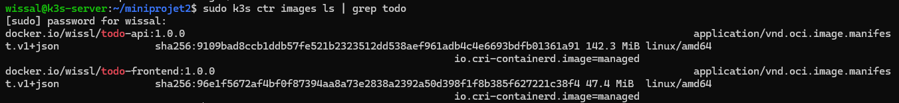
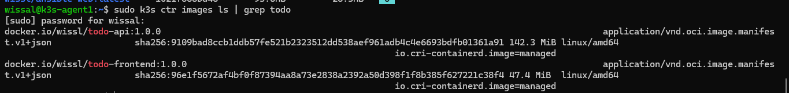
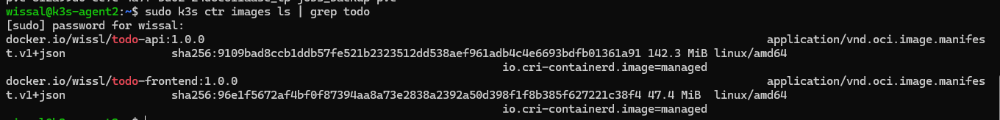

### E2 : namespace, quota, LimitRange
```
$ kubectl describe quota -n todo
Resource                Used  Hard
limits.cpu              0     4
limits.memory           0     4Gi
persistentvolumeclaims  0     5
pods                    0     20
requests.cpu            0     2
requests.memory         0     2Gi

$ kubectl describe limitrange -n todo
Type        Resource  Default Request  Default Limit
Container   cpu       50m              200m
Container   memory    64Mi             256Mi
```
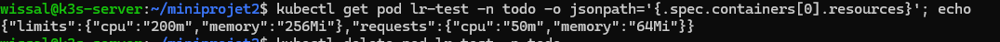

### E3 : ConfigMap et Secret
```
$ kubectl get configmap,secret -n todo
configmap/app-config         4      7s
configmap/kube-root-ca.crt   1      5m56s
secret/db-credentials   Opaque   2      7s
```
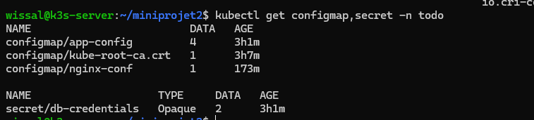

### E4 : aucun secret réel dans Git
`git check-ignore -v k8s/10-config/secret.yaml` doit citer la règle de `.gitignore`, et `git ls-files | grep -i secret` ne doit afficher que `secret.example.yaml`.
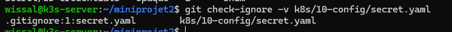

### E5 : StatefulSet, PVC et Service headless
```
$ kubectl get pods -n todo
db-0   1/1   Running   0   65s

$ kubectl get pvc -n todo
data-db-0   Bound   pvc-fc72fd02-05d1-4c61-8b49-5405d77b0a2c   1Gi   RWO   local-path
```
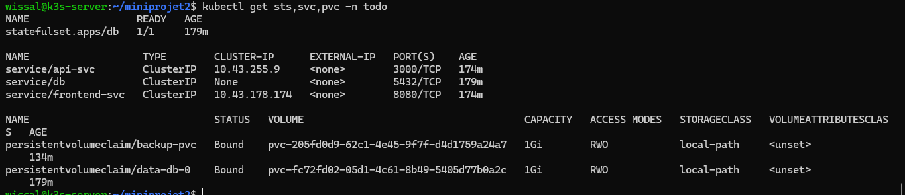

### E6 : persistance des données
Après `kubectl delete pod db-0 -n todo`, `db-0` revient sur le même nœud et les données sont identiques :
```
$ kubectl get pod db-0 -n todo -o wide
db-0   1/1   Running   0   29s   10.42.2.47   k3s-agent2

$ SELECT * FROM tasks;
 id |    title     | done
----+--------------+------
  1 | test k8s     | f
  2 | kuberneties  | f

$ sudo ls /var/lib/rancher/k3s/storage/      (sur k3s-agent2)
pvc-fc72fd02-05d1-4c61-8b49-5405d77b0a2c_todo_data-db-0
```
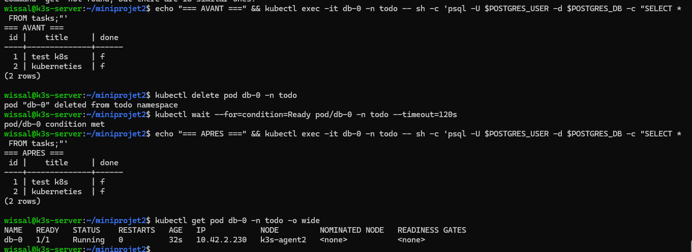

### E7, E8, E9 : démarrage ordonné, ressources, sondes
```
$ kubectl get pods -n todo -o wide
api-...-4p7j2   1/1   Running   10.42.1.60   k3s-agent1
api-...-b5kl9   1/1   Running   10.42.2.25   k3s-agent2
db-0            1/1   Running   10.42.2.19   k3s-agent2
frontend-...    1/1   Running   10.42.2.26   k3s-agent2

$ kubectl logs deploy/api -n todo
API listening on 3000
DB connection OK, table ready
```
Chaîne complète frontend → API → base testée par `curl` :
```
$ curl -s localhost:8081/api/tasks
[]
$ curl -s -X POST localhost:8081/api/tasks -H 'Content-Type: application/json' -d '{"title":"test k8s"}'
{"id":1,"title":"test k8s","done":false}
```
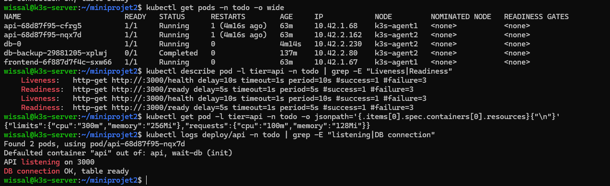

### E10 : Ingress, seul le frontend est exposé
```
$ kubectl get ingress -n todo
todo-ingress   traefik   app.k3s.local   172.25.240.127,172.25.244.254,172.25.252.47   80
```
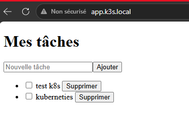

### E11 : sauvegarde et restauration
```
$ kubectl get jobs,pods -n todo
job.batch/test-backup   Complete   1/1   8s
pod/test-backup-zn5sn   0/1   Completed

Dump utilisé : dump-20261024-2001.sql
$ DELETE FROM tasks WHERE id=1;      -> DELETE 1   (reste seulement l'id 2)
$ TRUNCATE tasks;                    -> TRUNCATE TABLE
$ restauration du dump               -> COPY 2
$ SELECT * FROM tasks;               -> id 1 « test k8s » et id 2 « kuberneties » de nouveau présents
```
Après durcissement du CronJob : `job.batch/test-sec   Complete   1/1   6s`.
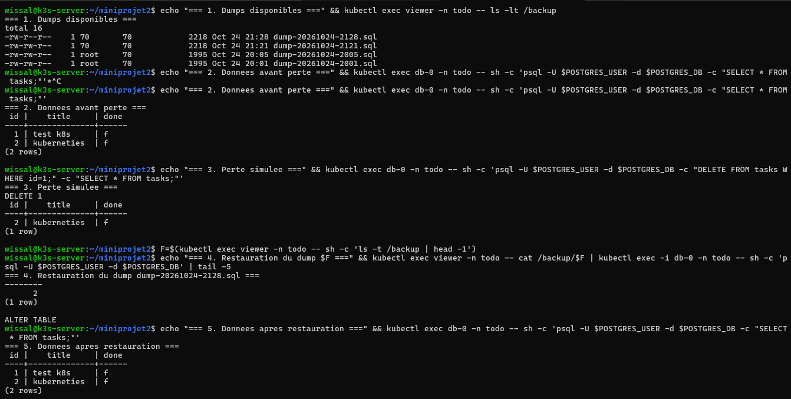

### E12 : RBAC
```
$ kubectl auth can-i list pods   --as=system:serviceaccount:todo:dev-viewer -n todo   -> yes
$ kubectl auth can-i delete pods --as=system:serviceaccount:todo:dev-viewer -n todo   -> no
$ kubectl auth can-i get secrets --as=system:serviceaccount:todo:dev-viewer -n todo   -> no
$ kubectl get pod -n todo -l tier=api -o jsonpath='{.items[0].spec.serviceAccountName}'   -> api-sa
$ kubectl exec deploy/api -n todo -- ls /var/run/secrets/kubernetes.io
ls: /var/run/secrets/kubernetes.io: No such file or directory
```
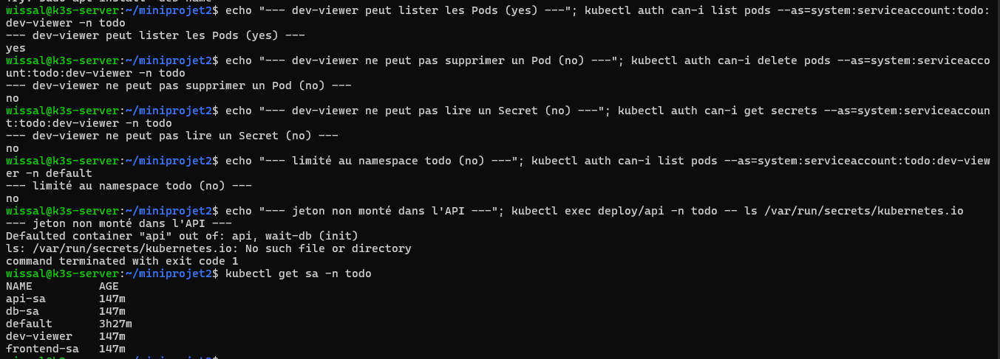

### E13 : durcissement des Pods
```
$ kubectl exec deploy/api -n todo -- id
uid=1000(node) gid=1000(node) groups=1000(node)

$ kubectl get pod db-0 -n todo -o jsonpath='{.spec.containers[0].securityContext}'
{"allowPrivilegeEscalation":false,"capabilities":{"add":["CHOWN","SETUID","SETGID","FOWNER","DAC_OVERRIDE"],"drop":["ALL"]}}
```
Test du niveau `restricted` sur le namespace (les Pods API et frontend recréés passent) :
```
Warning: db-0: unrestricted capabilities, runAsNonRoot != true
Warning: db-backup-29881205-xplwj (and 1 other pod): allowPrivilegeEscalation != false, unrestricted capabilities, runAsNonRoot != true, seccompProfile
```
Le namespace est ensuite remis à `baseline`.
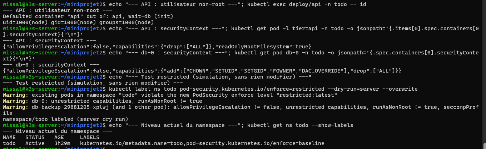

### E14 : NetworkPolicies et tests de blocage
Résultats : API → db `open` (exit=0) ; intrus et frontend → db `exit=1` ; job de sauvegarde `Complete 1/1` ; `get netpol` liste 4 politiques.
```
$ kubectl exec deploy/api -n todo -- sh -c 'nc -zv -w 3 db 5432; echo exit=$?'
db (10.42.2.154:5432) open
exit=0
```
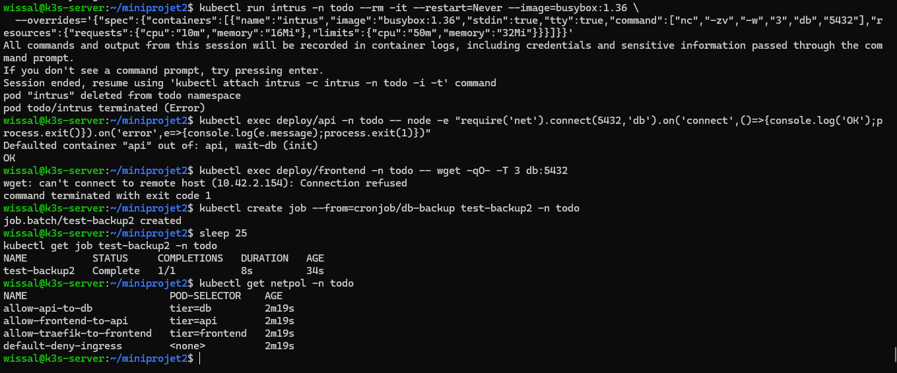
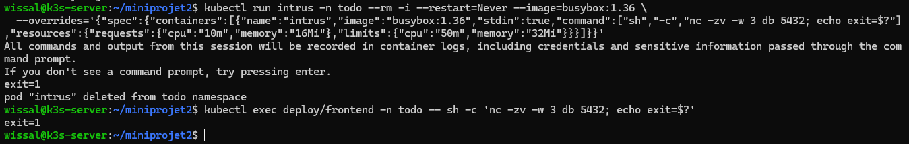
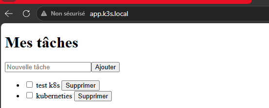

### E15 : dépôt Git
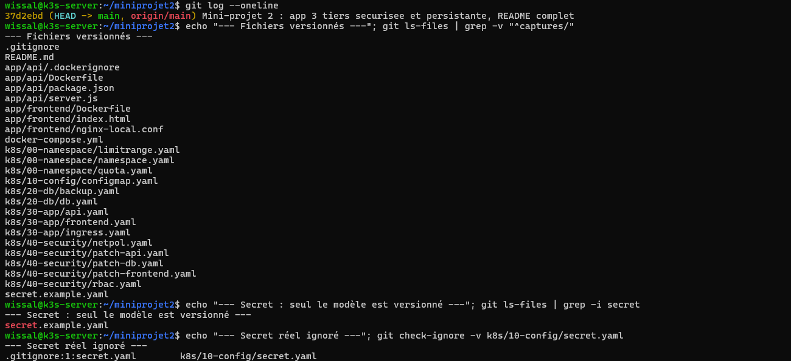

### Captures des difficultés rencontrées
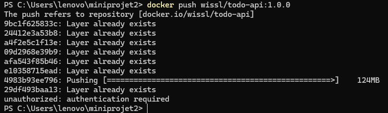
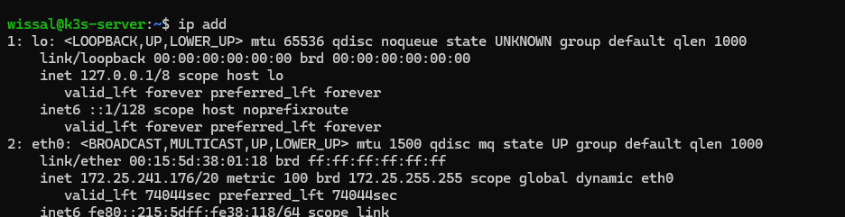
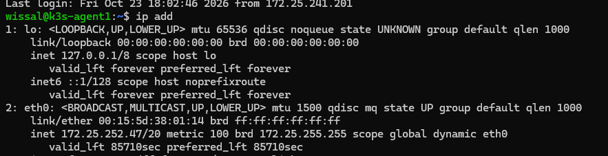
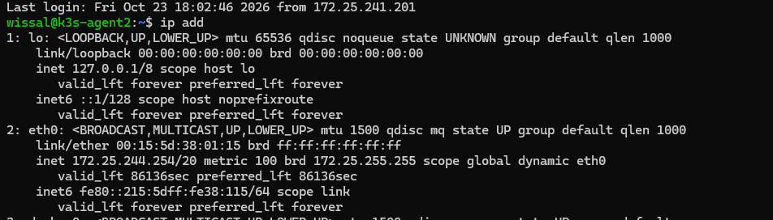

## 12. Difficultés rencontrées et enseignements

- **IP DHCP du master modifiée** : les agents sont passés `NotReady` (`K3S_URL` périmé) et un nœud fantôme est réapparu. Correction de `K3S_URL`, redémarrage de `k3s-agent`. Enseignement : fixer les IP (netplan ou réservation DHCP) avant de travailler.
- **Push Docker Hub en échec** (`unauthorized` sur la couche de 124 Mo) : bascule sur l'option B (`docker save` puis `k3s ctr images import` sur chaque nœud, avec `imagePullPolicy: IfNotPresent`).
- **Ordre d'application** : `limitrange.yaml` appliqué avant le namespace (ordre alphabétique) ; préfixer les fichiers par un numéro.
- **Titres vides acceptés** par l'API : validation ajoutée côté API et frontend (correctif `sed` bloqué par l'expansion `!` de bash, refait en Python).
- **API plantée quand la base disparaît** : les routes `/tasks` n'ont pas de `try/catch`, le processus quitte (exit 1) puis Kubernetes le relance. Amélioration possible : gérer les erreurs de requête et publier une image `1.0.1`.
- **`CrashLoopBackOff` de la base avec `drop ALL`** (41 min) : cause identifiée (l'entrypoint exige quelques capabilities), correction ciblée (cinq capabilities), données intactes car le PVC n'a pas été touché.
- **Preuve de blocage réseau** : un `Connection refused` n'est pas un blocage (la base a répondu) ; un témoin positif avec le même outil est nécessaire pour valider les échecs.
- **Limite connue** : `local-path` lie la base et la sauvegarde à un nœud ; pas de politique `Egress` ; manifestes de base non durcis (patchs séparés dans `40-security/`).
